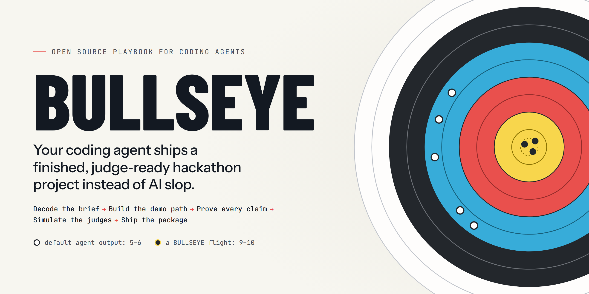

<p align="center">
  
</p>

<p align="center">
  <b>The hackathon playbook for coding agents.</b><br>
  Give it to Claude Code, Codex, Cursor or any agent that reads skills, and it runs your entry from the problem statement to the podium.
</p>

<p align="center">
  <a href="LICENSE"></a>
  
  
  
</p>

---

## Why this exists

A coding agent can build a working hackathon project in an afternoon. Judges now see dozens of them per event: the purple gradient hero, the three feature cards, the chatbot with a nice skin, the README that describes instead of proves, the demo that dies when the venue Wi-Fi does. They work. They read as generated. They score a 5 or a 6, and they do not make the final.

BULLSEYE is the method that moved my entries from that ring to the gold one, written down so an agent can follow it. It is distilled from 30+ hackathons (10+ finals, 5+ podiums): every rule, template and script here came out of a real build, and the field notes say which one.

What changes when your agent follows it:

- **It reads the rubric before it writes code**, picks the problem for win probability, and checks whether the sponsor's technology is load-bearing or decoration.
- **It builds the demo path first** and deploys on day 1, with a demo layer that cannot die: labelled live, scripted and recorded modes, seeded data with planted stories, a smoke test that asserts the rehearsed numbers.
- **It keeps the model away from the numbers.** The engine decides; the model narrates. Every figure comes from one facts file and is re-measured by one command.
- **It designs from the subject's own world** instead of the default look, and polishes with a separate critic that scores screenshots and measurements, never the builder's story.
- **It simulates the judges cold**, fact-checks their findings, and fixes what is real.
- **It ships the whole package**: a README a judge can use in 60 seconds, paste-ready form answers, a deck rendered and checked like code, a demo video under the cap, and a finale runsheet rehearsed until boring.

## Install

**Claude Code** (skills and subagents):

```text
/plugin marketplace add SaudSatopay/bullseye
/plugin install bullseye@bullseye
```

**Codex, Cursor, Gemini CLI, GitHub Copilot, OpenCode and other agents** (skills, via the open Agent Skills format):

```bash
npx skills add SaudSatopay/bullseye
```

**No install:** clone it next to your project and point your agent at it.

```bash
git clone --depth 1 https://github.com/SaudSatopay/bullseye .bullseye
```

Then tell your agent: *"Read .bullseye/AGENTS.md and run the bullseye skill for this hackathon."* Add `.bullseye/` to your `.gitignore`.

[docs/install.md](docs/install.md) covers each agent, updating, and what works where.

## Use it

Start a new event in plain words, with the link, the problem statement or the rules page:

```text
Use bullseye for this hackathon: <link to the event page>. Decode the brief, pick the
strongest problem for win probability, and set up BULLSEYE.md.
```

After that the session protocol does the rest: `next` does the next thing, `status` tells you where you stand against the deadline, and `handoff` closes a session so the next one (or a teammate's agent) resumes exactly where you stopped.

| Installed as | Slash commands |
|---|---|
| Skills (`npx skills add`) | `/bullseye start <link>`, `/bullseye next`, `/brief-decoder`, `/prove-it` … |
| Claude Code plugin | `/bullseye:bullseye start <link>`, `/bullseye:bullseye next`, `/bullseye:prove-it` … |

More prompts for every phase are in [docs/prompts.md](docs/prompts.md).

## The flight

One control file, `BULLSEYE.md`, holds the contract, the thesis, the plan, the claims, the judge rounds and the handoff. Each phase is a skill that reads it and writes its own section.

| Phase | Skill | What you get |
|---|---|---|
| Intake | [`brief-decoder`](skills/brief-decoder/SKILL.md) | Every rule, limit and criterion in one contract; the problem chosen for win probability; a competitive scan; the battle plan |
| Idea gate | [`idea-round`](skills/idea-round/SKILL.md) | A concept brief, idea deck and form answers that survive a skeptical shortlist, with every number labelled |
| Build | [`build-sprint`](skills/build-sprint/SKILL.md) | The golden path built first, deployed on day 1, with a demo layer that cannot die and AI features that are honest by construction |
| Polish | [`missile`](skills/missile/SKILL.md) | A design system from the subject's own world, one signature moment, and a sense, score, fix loop until every craft dimension is at 9 |
| Proof | [`prove-it`](skills/prove-it/SKILL.md) | A claims ledger, one facts file, a re-measure command, honest evals against real baselines, and a limits document |
| Judging | [`judge-panel`](skills/judge-panel/SKILL.md) | Cold, fresh-context judge rounds against the event's own rubric, and mock Q&A rehearsal |
| Package | [`submission-pack`](skills/submission-pack/SKILL.md), [`demo-video`](skills/demo-video/SKILL.md), [`pitch-deck`](skills/pitch-deck/SKILL.md) | A judge-first README, paste-ready answers, a final sweep that catches the slips, a scripted video, decks rendered and QA'd as code |
| Finale | [`finale-pitch`](skills/finale-pitch/SKILL.md) | A runsheet with exact inputs, a timed script with a 90-second cut, a Q&A bank, and a pre-flight with a decision rule |
| Portfolio | [`hackathon-tracker`](skills/hackathon-tracker/SKILL.md) | Every event you are in, deadlines in your time zone, verified statuses, and lessons kept |

[`bullseye`](skills/bullseye/SKILL.md) is the flight director that sequences all of it. [docs/method.md](docs/method.md) explains the method for humans in ten minutes.

## The law

The ten rules every skill enforces. [The evidence behind each one](skills/bullseye/references/law.md) is in the field notes.

1. Decode the rubric before writing code.
2. The judge is a user.
3. The engine decides, the model narrates.
4. Build the demo path first, and deploy on day 1.
5. The demo cannot die.
6. Every number is measured, labelled and identical everywhere.
7. Say the limits out loud before judges find them.
8. One signature moment, drawn from the subject's own world.
9. Simulate the judges cold, then fact-check them.
10. Submit early, tag it, and never edit after the deadline.

## Field-tested

A few of the builds this came from (the full set is in [docs/field-notes.md](docs/field-notes.md)):

- **Trinetra** (ET AI Hackathon 2.0): eight fresh-context judge rounds moved the internal score from 7.3 to 8.5, and every finding was checked against the code before it was fixed.
- **Detour** (Graph Hacks 2026): one command re-measured all 16 README claims against an independent reimplementation and failed on any drift; a scan of about 351 competitor repositories changed the idea on day 1.
- **ORCA** (Smart India Hackathon 2026, then Vibeathon Stage 2): a generic dark-glass UI replaced by a living nautical chart, with the design rules enforced by unit tests; at the surprise-challenge round, a brief handed over at 12:05 shipped by 14:50.
- **MuleShot** (Bank of India × IIT Hyderabad): the idea proposal proved its core on the organiser's own data, and turned a leakage audit into the hero of the pitch.
- **Dhaal** (MUJ HackX 4.0): three people, three agent sessions, one repo, 131 commits in about 39 hours, with lanes, contract-first APIs and a blind evaluation published with its misses.

## What is inside

```text
skills/        twelve Agent Skills, one folder each (SKILL.md, references/, assets/, scripts/)
agents/        five Claude Code subagents: missile-recon, missile-critic, missile-builder,
               hackathon-judge, claims-auditor
docs/          the method, field notes, install guide, prompt cookbook
scripts/       repository tooling (validator, banner render)
tests/         node:test suites for every bundled script
```

Every bundled script is tested (`node --test tests/`) and the repository checks itself (`node scripts/validate.mjs`): Agent Skills spec, links, manifests, secrets, and no em dashes anywhere.

## Works with

| Agent | Skills | Subagents | Notes |
|---|---|---|---|
| Claude Code | Yes (plugin or `npx skills`) | Yes | Plugin skills are namespaced `/bullseye:<skill>`; subagents `bullseye:<agent>` |
| Codex | Yes (`.agents/skills`) | No | Fresh-context judge and critic steps run in a new session with the prompt from the skill's `assets/` |
| Cursor, Gemini CLI, Copilot, OpenCode, others | Yes, via `npx skills add` | No | Same fallback as Codex |
| Any other agent | Read `AGENTS.md` from a clone | No | Everything is Markdown and plain scripts |

Scripts need Node 20+; some need Python 3.10+ with optional libraries (PyMuPDF, python-pptx, qrcode, edge-tts) and print an install hint when one is missing.

## Integrity

Hackathons run on trust. BULLSEYE is built to win honestly:

- Follow the event's rules over anything here (pre-existing work, AI use and disclosure, licences, anonymity).
- Never fabricate a screen, a metric, a testimonial or a result. Label what is simulated, projected, a target or illustrative, on the artifact itself.
- Never use an AI to answer real judges live on your behalf. Rehearse with the mock judge instead.
- Disclose what your coding agent did, plainly, in the README.

## Contributing

Lessons from your own hackathons make this better. Read [CONTRIBUTING.md](CONTRIBUTING.md): every new rule needs a field note saying where it was paid for.

## Credits

Written by [Saud Satopay](https://github.com/SaudSatopay) from 30+ hackathon builds, with Claude Code as the pair programmer. The `missile` polish loop is Saud's own skill. BULLSEYE recommends, and does not bundle, several excellent third-party skills (Anthropic's frontend-design, Impeccable, Hallmark, the Taste skill, Emil Kowalski's skills, Vercel's agent skills); their authors own them.

## Licence

[MIT](LICENSE).
