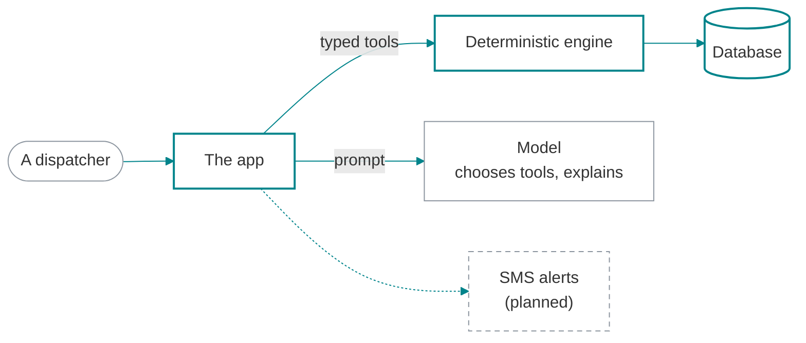

# README for judges

A judge gives a README about two minutes. They decide on the first screen, click the first link, and check one number. Everything below serves those three acts: a claim they can test, a link that lands on the product working, and numbers that are re-measured somewhere they can see.

The structure comes from the builder's strongest READMEs: Detour (Graph Hacks 2026), SunPath (FlowZint AI Hackathon 2026), RegSutra (SEBI Securities Market TechSprint 2026) and FLOODLIGHT (MUSA CodeX 2026). `../assets/README.template.md` is the skeleton; this file explains it.

> Field note (Detour · Graph Hacks 2026): At iteration 1 the README described the product and its own checks. The judge path, the Evidence table against baselines, the organisers' guidance point by point and "Where we lose" were added after the deadline, and they are what made it a judge's document.

## 1. The order, and why

| # | Section | Why it is there | A strong opener, from a real README |
|---|---|---|---|
| 1 | Hero | The first screen decides. The live OG image keeps the README identical to production | SunPath's hero is `https://<host>/opengraph-image`, so it can never go stale |
| 2 | One bold claim sentence | A judge needs the claim before the features | "When a New York subway line breaks, Detour measures what the rest of the city can still carry." |
| 3 | Badges with real numbers | Each is a claim with a link to its proof | "pnpm judge: 16/16 claims re-measured", linked to CLAIMS.md |
| 4 | Deep links | One click lands each page in the state worth seeing | `/control?scenario=l-canarsie&run=1`, `/riders?rider=aisha` |
| 5 | For judges: 60 seconds | Three or four clicks, what to look for, the caveat | "Report Aisha's elevator fixed first. One memory write closes the old fact..." |
| 6 | Evidence | What was tested against honest baselines, with results | "Every result below is committed with the script that produced it." |
| 7 | The judging criteria, point by point | The rubric in the organiser's words, each mapped to a place to look | "What the organisers' guide asks for \| In Detour" |
| 8 | What it does | Captioned production screenshots, desktop and phone | FLOODLIGHT's 2x2 gallery includes the quiet day that sends zero alerts |
| 9 | How it works | One diagram and three or four bolded rules | "**The model never writes Cypher.** It picks from a fixed catalogue of typed tools." |
| 10 | Why the sponsor's tech | The organiser's own test, answered head-on | "Each step is a graph question that a table or a vector store answers badly:" |
| 11 | Where we lose | Losses said before a judge finds them | "Results that went against Detour, or that it cannot show yet:" |
| 12 | Proof | Check \| Result, including Lighthouse | "pnpm judge: all 16 re-measured and matched" |
| 13 | Run it locally | Works without keys, verified from a fresh clone | RegSutra: "That's the whole setup. No API keys, no cloud, no database ..." |
| 14 | Data | Every source linked; sample data labelled | "The remembered riders, past incidents, playbooks and the agency's people and decisions are sample data, labeled as such. Detour is not affiliated with the MTA." |
| 15 | Team and AI assistance | Plain disclosure of what the coding agent did | "it did much of the research, design, code, tests and documentation under my direction" |
| 16 | License and credits | Fonts, photos, UI kits, data licences | ORCA's README credits Open-Meteo, OBIS, OpenStreetMap and each typeface, and a `LICENSES.md` beside the vendored UI kits credits each kit |

Optional sections earn their place only with evidence: "After the deadline" (see `integrity.md`), "Use it from an agent" (an MCP server with a one-line `claude mcp add`), a failure ledger ("Failure we hit | Defense in the code", SunPath), "What to watch for during the replay" (time | what happens | why it matters, FLOODLIGHT), and a callout that pre-empts the obvious objection (FaceAttend's "Model size vs app size").

Cut: a table of contents on a short README, a features list without numbers, a roadmap longer than the product, emoji headings, three README polish passes while the product has no tests (CrackWatch's lesson).

## 2. Hero and claim

- Use the live OG image URL when the host serves one (Next `app/opengraph-image.tsx`), else `public/og.png` rendered from the design tokens. Both come from `media-specs.md`.
- Wrap it in a link to the live demo. Alt text is a sentence a screen reader can use: the name, the claim and the numbers printed on the image.
- The claim sentence: "When <situation>, <name> <verb> <outcome>", or a number-first line. It is a claim a judge can check, never a greeting, a slogan or a category ("an AI-powered platform").

## 3. Badges

Badges are claims, so they follow the claim rules.

- Every badge carries a real number or a fact and links to where it is proven: tests to the Proof section, claims to CLAIMS.md, the live demo to its URL, the track to the event page.
- No badge for a number nobody can check, and no CI badge unless CI runs on every push. Detour's workflow never activated (the token lacked the `workflow` scope), so its proof page line about running on every change was untrue until the page was corrected.
- Order: live demo, track, the proof badge (claims re-measured N/N), tests. Stack badges are optional and come last, or not at all.
- Colours are the palette: the accent as the message colour and the ink as `labelColor`, both without `#`.
- The alt text spells the badge out ("Tests: 231 unit, 19 end-to-end").
- The final sweep reads `badge/tests-<N>` and compares it with facts.json, so a stale badge fails the sweep.

shields.io static badge syntax: `https://img.shields.io/badge/<label>-<message>-<colour>?style=flat-square&labelColor=<colour>`.

| In the text | Write |
|---|---|
| a space | `_` or `%20` |
| `_` | `__` |
| `-` | `--` |
| `/` | `%2F` |
| a middot | `%C2%B7` |
| `%` | `%25` |

## 4. Deep links

A deep link opens a page in the state worth judging: `?scenario=`, `?demo=safe`, `?autorun=1`, `?step=4`, `?tab=`, `?rider=`. Build them into the product early (sibling skill build-sprint); a judge who lands on an empty form leaves.

- Every deep link in the README is opened logged out, in a private window and on a phone before submitting.
- `?autorun=1` style links run the demo by themselves (RegSutra's `/ingest?autorun=1`); add `&fast=1` for rehearsal speed, never in the README.
- When a run depends on a free model quota, say what happens when it is spent, and label that mode on screen.

## 5. For judges: 60 seconds

Three or four numbered steps. Each is a deep link, an action, and what to look for with the number they will see. Then one caveat. Detour's version, generalised:

```markdown
1. **[Run the closure](https://<host>/control?scenario=one&run=1).** The model lists its tools and works through it; each step shows its arguments, timing and rows.
2. **[Ask the brain](https://<host>/brain)** "Is the elevator at Times Sq working?" The answer quotes the source feed and when it was read.
3. **[Open the proof](https://<host>/proof)**, or re-measure everything: `pnpm judge` checks the README's 16 claims and fails loudly on any mismatch.
```

## 6. Evidence and losses

- "What was tested | Result" rows compare against honest baselines: the same model without your tool, a rules-only floor, the organiser's own baseline through the same pipeline, a placebo arm. Put the held-out size and how it was split in the row.
- Say where you lose in the same document: Detour's rules router scored 101 of 101 and the README says the model "adds no accuracy over plain rules" on those questions. A loss you publish costs less than one a judge finds.
- Results come from sibling skill prove-it: CLAIMS.md maps each README claim to the command that measures it, and facts.json holds the values.

## 7. The rubric, point by point

Two tables. The first maps each criterion, in the organiser's words, with its weight, to a place a judge can look: a link, a file, a command. The second maps each track to the screen that shows it. When the rubric is not published, map the organiser's guidance the same way. Mark rows honestly as built, demonstrated or planned; "planned" in a rubric table is better than a claim the product cannot back.

## 8. Screenshots and alt text

- Capture from the production build, at 1440 px and 390 px, at device scale factor 2, after fonts and entrance animations settle (`media-specs.md`). A dev-server capture can carry the Next.js dev indicator.
- Captions say what to notice ("The G overloads in red, max flow moves 17,167 of 18,432 riders an hour"). Alt text describes the screen and its numbers; it never says "screenshot of".
- Show the negative case when the product has one (FLOODLIGHT's quiet day: zero alerts, the blocked drain still caught) and one phone shot.
- After any redesign, re-shoot the README images, the OG card and the GIF in the same change.

> Field note (RegSutra · SEBI Securities Market TechSprint 2026): The posture screenshot near the top of the README was captured from the dev server, so the Next.js dev indicator sits over the sidebar footer in the first screenshot a judge sees.

## 9. Diagrams

GitHub draws Mermaid in the reader's theme, light or dark. This pattern was render-checked in both with `scripts/readme-preview.mjs`: GitHub's own per-theme text colours, transparent fills, the accent on strokes, planned parts dashed.



A `%%{init: {'theme': 'base', 'themeVariables': {...}}}%%` line fixes one palette for both GitHub themes. When the palette's fills must show, it works with these values and these measured limits:

```text
%%{init: {'theme': 'base', 'themeVariables': {'primaryColor': '#ffffff00', 'primaryTextColor': '#8b949e', 'primaryBorderColor': '#00848b', 'lineColor': '#00848b', 'edgeLabelBackground': '#ffffff00', 'clusterBkg': '#ffffff00', 'clusterBorder': '#8b949e'}}}%%
```

- Text must be a mid grey such as `#8b949e`, which reads on both white and GitHub's dark background.
- Do not set `fontFamily`: Mermaid measures the labels in one font and draws them in another, and the labels came out clipped ("Graph engin").
- Use fully transparent hex values, not the keyword `transparent`: the keyword gave edge labels grey boxes.
- Even then, Mermaid fades the edge-label background to half-opacity white: invisible on GitHub's light theme, a light grey box on the dark one. Keep edge labels short, or use the classDef pattern above.

Other rules: line breaks in labels are `<br/>`; a Mermaid hexagon `id{{text}}` is syntax, not a placeholder (the sweep knows); when Mermaid cannot carry the design, render an architecture HTML page to PNG at 2x with dashed "(planned)" boxes (VyaparAI did, at 3200 by 2120), using the HTML-to-image pipeline in sibling skill pitch-deck.

## 10. Why the sponsor's tech

Answer the organiser's question in the first line: does the product still work without it? Detour's organiser put it bluntly (a product that still works once FalkorDB is taken out leaves the graph as decoration), and the README answered with the reasons. Then one row per question only this tech answers well here, with the primitive and the number it produced. For platform sponsors, tell the story as subtraction: CrackWatch listed ten primitives and a strikethrough line of everything the team did not have to build.

## 11. Run it locally

- The default path runs without keys: a demo, replay or scripted mode, labelled on screen. Keys add the live mode and are explained one by one in `.env.example`.
- The commands are the ones verified from a fresh clone in a new folder, outside synced folders. Write the time they took.
- A "Command | What it checks" table turns the scripts into evidence (`pnpm judge`, the eval commands, the e2e suite with `BASE_URL`).
- Local URLs stay in code blocks or code spans. GitHub turns a bare `http://localhost:3000` in prose into a link that is dead for every judge, and the sweep fails on it.

## 12. Team and AI assistance

Say it plainly: what the coding agent did, what the people did, and how the output is verified. When the event names a required section (OpenAI Build Week wanted a section on the Codex collaboration), use that exact heading, add it to `requireSections` in sweep.config.json, and keep what it asks for, such as session IDs. Credit the template you started from. Never name a live AI that answers judges, because there should not be one.

> Field note (StorePilot · OpenAI Build Week): The rules made a README section on the Codex collaboration a hard requirement; nothing checked it at the end and the submitted README had no such section. The badge also said 14 tests passing while the suite had 21.

## 13. Render check (do it before every submission)

GitHub's renderer is the truth. A README that looks right in an editor can still break on GitHub: a Mermaid syntax error shows as an error box, an image under a gitignored folder is broken, a wide table scrolls.

1. Render with GitHub's own engine and wrap the result in github-markdown-css, light and dark, with Mermaid drawn:

   ```bash
   node "<submission-pack>/scripts/readme-preview.mjs" README.md --repo <owner>/<repo>
   ```

   It calls `gh api markdown -F text=@README.md -f mode=gfm -f context=<owner>/<repo>`, which renders an unpushed README exactly as GitHub will, and writes `readme-preview-light.html` and `readme-preview-dark.html`.
2. Look at both pages. In Claude Code, open them in the Browser pane; elsewhere, any browser or `playwright-cli`. The bar at the top counts Mermaid diagrams drawn, Mermaid errors, images loaded and broken, and blocks that scroll sideways.
3. Or let the script shoot them: `--shoot` takes 1000 px slices of both themes with the Playwright installed in the project and exits 1 on any Mermaid error or broken image.
4. Read every slice in both themes: diagrams legible in dark, transparent PNGs not vanishing on dark backgrounds, badges rendered, tables not cramped, captions under the right images.
5. Fix, re-render, and run the final sweep, which also fails on relative links and images that are missing, that git ignores, or whose case differs from the file's (Windows and macOS forgive `Hero.PNG` for `hero.png`; GitHub does not).

## 14. Failures this structure prevents

| Failure | Seen in | Prevention |
|---|---|---|
| Badge and text said 58 tests; the suite, deck and voiceover said 59 | Bridge · Slack Agent Builder Challenge | Counts from facts.json; the sweep compares badges and text |
| A mandatory README section missing | StorePilot · OpenAI Build Week | The requirement as an R line plus `requireSections`; the sweep fails without the heading |
| README media and OG image older than the redesign | Detour · Graph Hacks 2026 | Re-shoot media in the same change as any redesign |
| Dev indicator in the hero screenshot | RegSutra · SEBI Securities Market TechSprint 2026 | Capture from the production build |
| Test counts drifting across documents (11, 20, 22, then 31) | FLOODLIGHT · MUSA CodeX 2026 | One facts file; documents read from it |
| A README that only described the product | Detour, iteration 1 | The 60-second path, Evidence and "Where we lose" |
